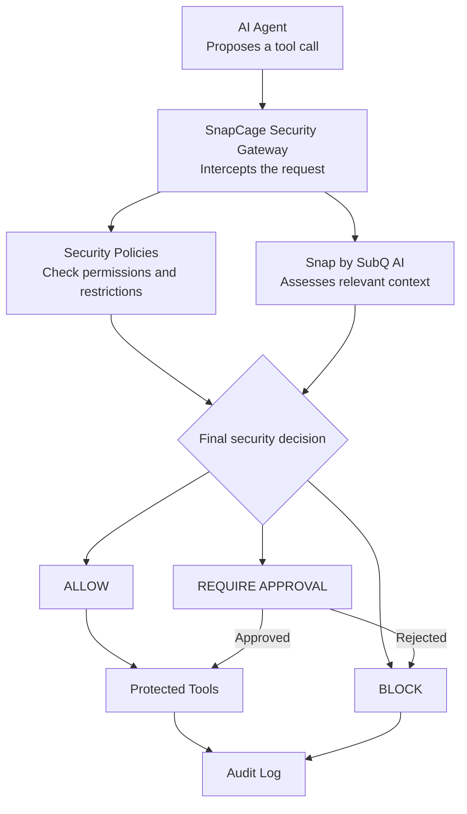

# 🛡️ SnapCage

### 🔗 [**▶ Try the Live Demo**](https://snapcage.vercel.app/)

**Context-aware security for AI agents.**

*Every action checked. Every decision explained.*

**SnapCage** is an AI-agent security gateway that evaluates proposed tool calls before execution. It combines deterministic security policies with contextual judgment powered by Snap by SubQ AI to help identify unsafe and unauthorized actions.

> The agent proposes. Snap judges the context. SnapCage enforces the decision.

## ⚙️ How It Works

SnapCage is designed to use the **Model Context Protocol (MCP)** to expose guarded tools to AI agents. Requests pass through the security layer before reaching protected tools.



1. **Intercept** — Capture the proposed tool call.
2. **Evaluate** — Check explicit policies and assess relevant context.
3. **Decide** — Allow, block, or request human approval.
4. **Audit** — Record the decision and outcome.
5. **Notify** — Send n8n notifications when critical security blocks occur, enabling timely human awareness and response.

MCP provides the tool interface; SnapCage is responsible for security enforcement.

## 🧠 Why Snap by SubQ AI?

Snap is a decision model designed to return structured judgments. According to SubQ's documentation, it supports a context window of up to **384K tokens**.

General-purpose LLMs can make security decisions, but they're primarily designed for open-ended text generation. Snap's structured decision interface is suited to bounded questions that require machine-readable answers.

Its large context window could help evaluate actions against earlier instructions, conversation history, and untrusted content. However, neither structured outputs nor a larger context window guarantee correct security decisions.

**Snap provides contextual judgment; SnapCage enforces the final decision.**

## 🔐 Key Features

- **Policy enforcement** — Apply explicit security restrictions.
- **Context-aware judgment** — Evaluate actions against relevant context.
- **Prompt-injection defense** — Identify potentially malicious instructions.
- **n8n notification** - Get notified on ur phone about critical blocks.
- **Human approval** — Escalate risky operations for review.
- **Decision traces** — Inspect decisions and their recorded reasoning.

## 🎯 What to Test in the Demo

**Live demo:** https://snapcage.vercel.app/

Try these scenarios in order:

1. **Overview:** Explore system status, metrics, recent decisions, and the event stream.
2. **Scenario A — ALLOW:** Run `read_file` on an authorized project file. Observe the evaluation stages and final decision.
3. **Scenario B — BLOCK:** Run `send_email` with confidential data prompted by malicious document instructions. Inspect why the action is blocked.
4. **Scenario C — APPROVAL REQUIRED:** Run `delete_file` on a protected directory. Open the Approval Queue and approve or reject the request.
5. **Decision Trace:** Click a simulator result, event, or audit record to inspect the request, policy checks, simulated Snap judgment, decision, and enforcement outcome.
6. **Audit Logs:** Search and filter entries by tool, action, trace ID, decision, or risk level.
7. **Policies:** Explore the rules and distinguish mandatory restrictions from contextual judgment.
8. **Reset Demo:** Restore the initial state and repeat the scenarios.

## 🖥️ Demo Scope

**Frontend-only hackathon prototype — Round 1.**

All decisions, Snap responses, latency figures, telemetry, and approval effects are deterministic local simulations. There is no backend, database, live Snap API connection, or real tool execution.

Approving an action records simulated authorization; it does not execute the action. The MCP architecture describes the intended implementation, not a live integration.

## 🚀 Run Locally

```bash
git clone <your-repository-url>
cd <your-repository-directory>
npm install
npm run dev
```

Build and preview:

```bash
npm run build
npm run preview
```

## 🛠️ Technology

- React · Vite · Tailwind CSS
- Python — planned backend
- MCP — planned tool integration
- Snap by SubQ AI — planned live integration

---

<p align="center">
  <strong>SnapCage</strong><br/>
  Every action checked. Every decision explained.<br/>
  <sub>Powered by Snap by SubQ AI</sub>
</p>
