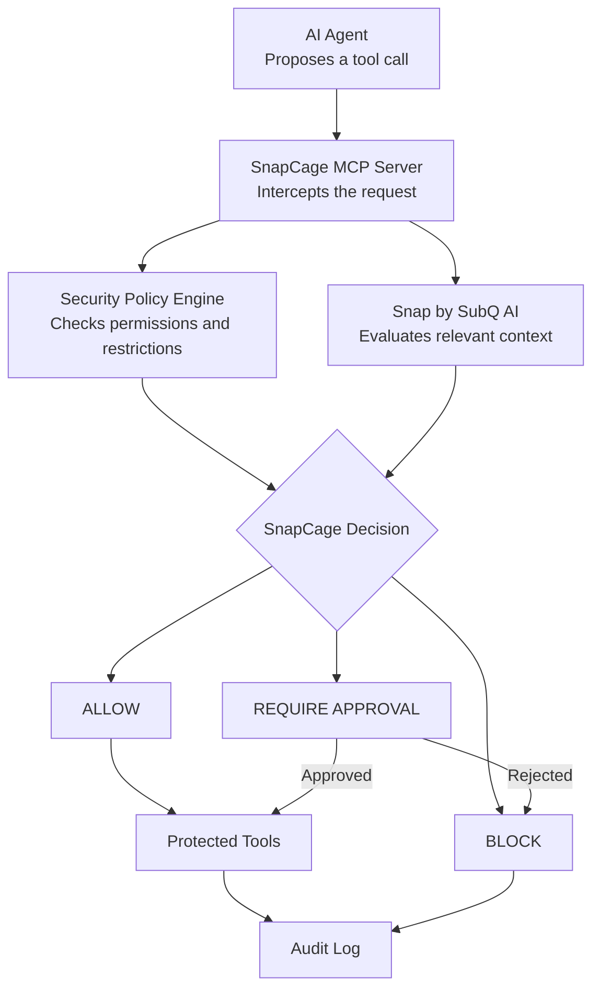

# 🛡️ SnapCage

### Context-aware security for AI agents.

**Every action checked. Every decision explained.**

AI agents can read files, call APIs, and execute tools. But malicious instructions hidden in documents or tool outputs can manipulate agents into performing actions their users never authorized.

**SnapCage is an AI-agent security gateway that evaluates proposed tool calls before execution.** It combines deterministic security policies with contextual judgment powered by Snap by SubQ AI to help identify unsafe and unauthorized actions.

> The agent proposes. Snap judges the context. SnapCage enforces the decision.

## ⚙️ How It Works

SnapCage is designed to use the **Model Context Protocol (MCP)** to expose guarded tools to AI agents. Each request passes through the security layer before reaching a protected tool.



1. **Intercept** — Capture the proposed tool call.
2. **Evaluate** — Check explicit policies and assess relevant context.
3. **Decide** — Allow, block, or require human approval.
4. **Audit** — Record the decision and outcome.

MCP provides the tool interface; SnapCage is responsible for security enforcement. This diagram describes the intended architecture, not a live backend in the current demo.

## 🧠 Why Snap by SubQ AI?

Snap is a decision model designed to return structured judgments rather than unrestricted text. According to SubQ's published documentation, it supports a context window of up to **384K tokens**.

General-purpose LLMs can make security decisions, but they're primarily designed for open-ended text generation. Snap's structured decision interface is suited to bounded questions where an application needs a machine-readable answer.

Its large context window could also help evaluate an action against earlier instructions, conversation history, and untrusted content—not just the latest tool call.

**Snap provides contextual judgment, not guaranteed security.** SnapCage remains responsible for enforcing mandatory policies and the final decision.

## 🔐 Key Features

- **Policy enforcement** — Apply explicit security restrictions.
- **Context-aware judgment** — Assess proposed actions against relevant context.
- **Prompt-injection defense** — Identify actions potentially influenced by malicious instructions.
- **Human approval** — Escalate selected risky operations.
- **Decision traces** — Inspect the reasoning and outcome of each simulated evaluation.

## 🎯 Demo Scenarios

| Scenario | Proposed action | Expected decision |
|---|---|---|
| A — Normal operation | Read an authorized project file | 🟢 ALLOW |
| B — Prompt injection | Email a confidential file due to malicious document instructions | 🔴 BLOCK |
| C — Destructive action | Delete a protected directory | 🟡 APPROVAL REQUIRED |

## 🖥️ Try the Demo

The interactive frontend includes:

1. **Overview** — System status, decision metrics, event stream, and recent decisions.
2. **Security Simulator** — Run scenarios A, B, and C and watch the simulated evaluation stages.
3. **Decision Trace** — Inspect the request, policy checks, simulated Snap judgment, final decision, and enforcement outcome.
4. **Approval Queue** — Approve or reject a simulated request and observe the updated interface.
5. **Audit Logs** — Search and filter decisions by tool, action, trace ID, outcome, and risk level.
6. **Policies** — Explore the illustrative security rules.

## 🚀 Run Locally

```bash
npm install
npm run dev
```

To build and preview the production bundle:

```bash
npm run build
npm run preview
```

## ⚠️ Demo Scope

**This is a frontend-only hackathon prototype.**

All decisions, Snap responses, latency figures, telemetry, and approval effects are deterministic local simulations. There is no backend, database, live Snap API connection, or real tool execution.

Approving an action records simulated authorization; it does not execute the action. The interface demonstrates the proposed security workflow, not production-grade enforcement.

---

<p align="center">
  <strong>SnapCage</strong><br/>
  Every action checked. Every decision explained.<br/>
  <sub>Powered by Snap by SubQ AI · AI-agent security gateway</sub>
</p>